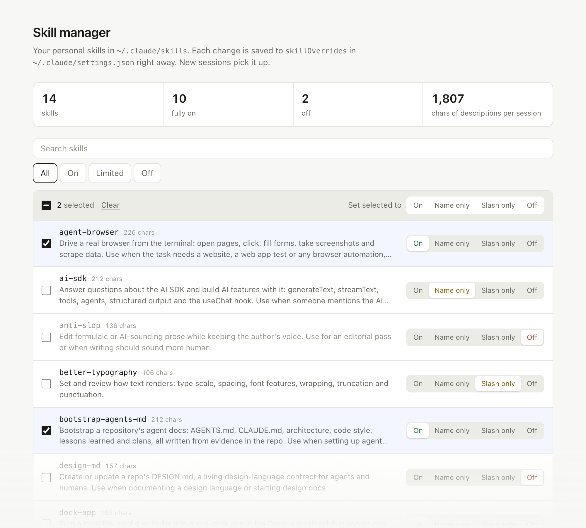
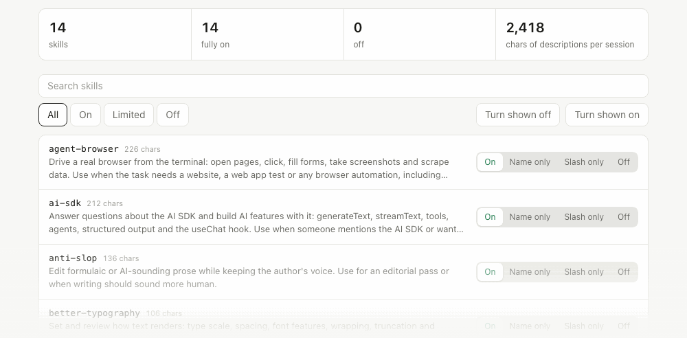
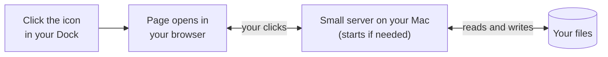

# Agent Skills

Skills you install once and then use by asking for them in plain words. They work with Claude Code and other agents that read the [Agent Skills format](https://github.com/vercel-labs/skills).

```bash
npx skills add nolly-studio/agent-skills
```

| Skill | What it does | Ask your agent |
| --- | --- | --- |
| [**skill-manager**](#skill-manager) | Puts an app in your Dock for turning Claude Code skills on and off | "Install the skill manager" |
| [**dock-app**](#dock-app) | Turns any file or setting on your Mac into a one-click app | "Make a Dock app for this config" |
| [**bootstrap-agents-md**](#bootstrap-agents-md) | Writes `AGENTS.md` and agent docs for a repo, from what is really in it | "Bootstrap the agent docs for this repo" |
| [**design-md**](#design-md) | Writes a `DESIGN.md` that tells agents how your UI should look | "Add a DESIGN.md for this project" |

---

## skill-manager

**Too many skills slowing your agent down? Click an icon in your Dock and switch them off.**

<picture>
  <source media="(prefers-color-scheme: dark)" srcset="images/skill-manager-dark.png">
  
</picture>

Every skill you install adds its description to every Claude Code session, whether you use it that day or not. With 100 skills, that is tens of thousands of characters before you type a word. This skill installs a small Mac app that shows each skill, how much it costs, and a switch to turn it down or off, one at a time or all at once.

### See it work



### Get it in 3 steps

1. **Install the skill**

   ```bash
   npx skills add nolly-studio/agent-skills --skill skill-manager -y
   ```

2. **Ask Claude Code** to "install the skill manager and put it in my Dock".
3. **Click the Skill Manager icon** in your Dock. The page opens in your browser.

Changes save the moment you click. New sessions use them.

### Change many at once

- **Everything:** the bar above the list reads "Set all 115 to". Click **Slash only** and every skill switches.
- **A selection:** tick skills, or click one and shift-click another to select the range between them. The bar switches to "Set selected to".
- **A search or filter:** with nothing ticked, the bar acts on what is shown, like "Set 12 shown to".

Picks stay while you search, so you can collect skills from several searches and change them together. Press Esc to clear.

### The four switches

| Switch | Claude sees | Cost per session | Use it for |
| --- | --- | --- | --- |
| **On** | Name and description | Full description | Skills you want Claude to reach for on its own |
| **Name only** | Name | A few characters | Skills with names that explain themselves |
| **Slash only** | Nothing | Nothing | Skills you start yourself by typing `/name` |
| **Off** | Nothing | Nothing | Skills you are not using right now |

Nothing is moved or deleted. Each switch writes Claude Code's own `skillOverrides` setting in `~/.claude/settings.json`, which is backed up before the first change.

### What it installs

```
/Applications/Skill Manager.app    # the icon you click
~/.claude/skill-manager/
  server.ts                        # tiny local server, only reachable from your Mac
  index.html                       # the page
  open.sh                          # starts the server if needed and opens the page
```

**Needs:** macOS and [Bun](https://bun.sh).

**Remove it:** ask Claude to uninstall the skill manager, or run:

```bash
lsof -t -iTCP:4477 -sTCP:LISTEN | xargs kill; rm -rf "/Applications/Skill Manager.app" ~/.claude/skill-manager
```

---

## dock-app

**Turn any file or setting on your Mac into an app you open from the Dock.**

The skill manager above was built with this skill. Use it whenever you want buttons and switches for something on your own machine: an app's settings, dotfiles, a folder of notes, a local database. A web page on the internet cannot touch those files. A dock app can, and it never leaves your Mac.



### Ask for it

```
Make a Dock app for editing my ~/.gitconfig
```

```
Give me a toggle page for the feature flags in config/flags.json, and put it in my Dock
```

### What your agent does

1. **Finds the right thing to change.** It looks for the app's official setting before touching any files.
2. **Builds a tiny server and one page,** starting from the files in `skills/dock-app/assets/`. No Electron, no build step.
3. **Wraps it in a Mac app** with `scripts/make-app.sh` and, if you say yes, pins it to your Dock.
4. **Tests it like you would use it:** opens it from a cold start, makes a change, checks the file, puts it back, and looks at the page in light mode, dark mode and phone width.

**Needs:** macOS and [Bun](https://bun.sh).

---

## bootstrap-agents-md

**Give any repo the docs an AI agent needs to work in it well.**

It reads the repo first, then writes each doc from what it finds, so nothing is copied in blind.

```
AGENTS.md                          # the entry point agents read first
CLAUDE.md                          # symlink to AGENTS.md
docs/
  agents/
    architecture.md                # how the system really fits together
    code-style.md                  # the conventions the code already follows
    lessons-learned.md             # grows as agents learn non-obvious things
  plans/
    README.md                      # how longer plans are written and kept
  release.md                       # how the project ships
.agents/
  skills/
    plan-mode/SKILL.md             # how to plan before big changes
    code-review/SKILL.md           # how to review with context
```

**Use it when** you set up a new repo for agents, move a proven setup to another codebase, or merge scattered `AGENTS.md`, `CLAUDE.md` and Cursor rules into one place.

**Principles:** every claim traces back to the repo; port the system, rewrite the content; docs stay alive as agents add lessons; commands come from the repo's own scripts; plan before large changes; short and accurate beats long and impressive.

---

## design-md

**Write down how your UI should look, so agents build on-brand.**

It creates a root `DESIGN.md` (colors, type, spacing, components, motion) plus a portable `frontend-design` skill. It checks the repo first and picks one of three modes, so it never overwrites a design you already have:

| Mode | When | What happens |
| --- | --- | --- |
| **Document** | The repo already has a design language | Writes it down, citing real files and tokens. Nothing in the design changes |
| **Merge** | Design docs already exist | Keeps the unique rules, removes duplicates, leaves one source of truth |
| **Propose** | A new project | Writes a one-page proposal and **waits for your approval** before the full doc |

```
DESIGN.md                              # the design contract
.agents/skills/frontend-design/SKILL.md
docs/plans/design-language.md          # propose mode only
```

**Principles:** the doc follows the code or your approval, never invention; describing is not a mandate to restyle; limits you can check ("one accent color per view") over vibes; every token named must exist in the code.

---

## Install

**All skills** (you pick in a prompt):

```bash
npx skills add nolly-studio/agent-skills
```

**One skill**, no prompts:

```bash
npx skills add nolly-studio/agent-skills --skill skill-manager -y
npx skills add nolly-studio/agent-skills --skill dock-app -y
npx skills add nolly-studio/agent-skills --skill bootstrap-agents-md -y
npx skills add nolly-studio/agent-skills --skill design-md -y
```

**By hand** for Claude Code: copy a folder from `skills/` into `~/.claude/skills/`.

**claude.ai:** add the skill's `SKILL.md` to project knowledge, or paste it into the chat.

Once installed, you do not call a skill directly. Ask for what you want, and the agent uses the matching skill.

## What is in this repo

```
skills/
  skill-manager/
    SKILL.md                 # install, check, remove
    scripts/install.sh       # copies the files, builds the app, optional Dock pin
    assets/                  # server.ts, index.html, open.sh
  dock-app/
    SKILL.md                 # find the setting, build, wrap, test
    scripts/make-app.sh      # turns any launcher script into a Mac app
    assets/                  # starter server.ts and open.sh
  bootstrap-agents-md/
    SKILL.md
    references/              # templates for each doc it writes
  design-md/
    SKILL.md
    references/              # DESIGN.md and frontend-design templates
images/                      # screenshots for this README
```

## License

MIT
